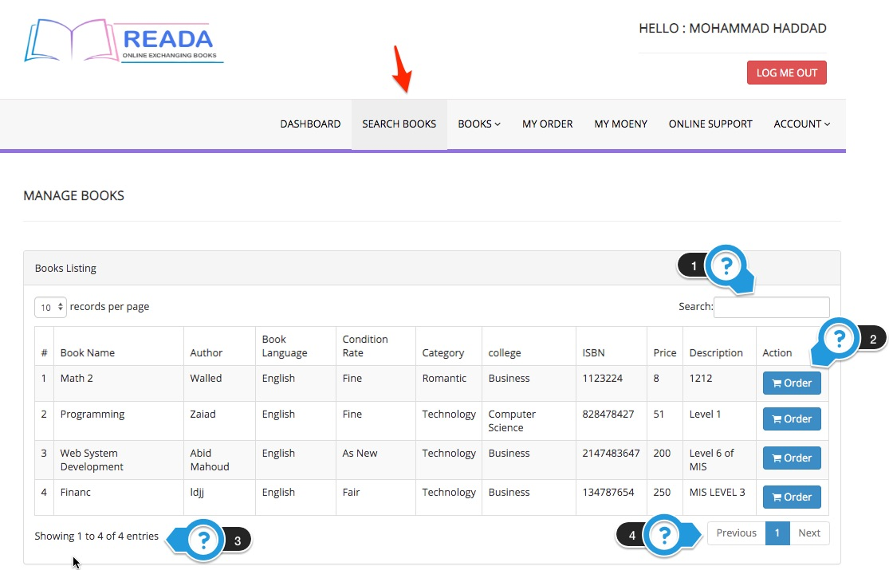
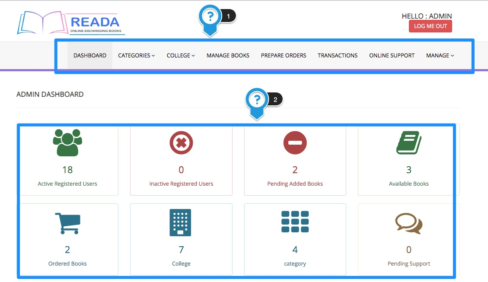

# Reada: Online Bookstore for Used Textbooks

Reada is a web-based system where university students can **buy and sell used textbooks** in an organized and easy way. It was built as a graduation project in 2019.

## The Problem

Every semester students have to buy several expensive books, then throw them away when the semester ends. Many students can't afford new books, and there's no organized place to collect and resell used ones.

## The Solution

Reada lets students:

- **Sell** the used books they no longer need and get back part of the original price
- **Buy** used books in good condition at a lower price
- Take better care of their books, share knowledge, and help the environment

## User Roles

| Role | Main features |
|------|---------------|
| **Student** | Sign up and log in, browse and search books, add books for sale, my books, ordered books, address, wallet / payments, profile, FAQs, support |
| **Admin** | Dashboard, manage books, categories and colleges, registered students, preparing orders, approving payments, shipping company accounts, answering support |
| **Shipping company** | Log in, dashboard, shipping requests, change password |

## Tech Stack

- PHP (PDO)
- MySQL
- HTML, CSS, Bootstrap, jQuery

## Project Structure

```
Reada/
├── src/                 # PHP source code (copy this into htdocs/reada)
│   ├── admin/           # Admin panel
│   ├── includes/        # Shared header, footer, DB config
│   └── assets/          # CSS, JS, fonts, images
├── database/
│   ├── ReadaDB.sql      # Database dump to import (with demo data)
│   ├── reada_schema.*   # Database design (SQL + MySQL Workbench model)
│   └── erd.png
└── docs/
    ├── report/          # Final report, submission, abstract, presentation, FAQs
    ├── diagrams/        # Context diagram, DFD, ERD, site map
    └── user-manual/     # Screenshots for student, admin and shipping company
```

## Running Locally

1. Install [XAMPP](https://www.apachefriends.org/) (or WAMP/MAMP).
2. Copy the `src` folder into `htdocs` and rename it to `reada`.
3. Open phpMyAdmin, create a database called `ReadaDB`, and import `database/ReadaDB.sql`.
4. If needed, change the database settings in `src/includes/config.php` and `src/admin/includes/config.php`.
5. Open <http://localhost/reada/>.

### Demo Accounts

| Role | Login | Password |
|------|-------|----------|
| Student | `student1@example.com` | `student123` |
| Student | `student2@example.com` | `student123` |
| Admin | `admin` | `admin123` |
| Shipping company | `DHL` | `1234` |

## Screenshots

| Student dashboard | Search books | Admin dashboard |
|---|---|---|
|  |  |  |

## Database Design


## Notes

- This is an academic project from 2019, so it isn't production-ready (for example, passwords are stored as MD5 hashes).
- The project started from an open-source PHP/MySQL *Library Management System* template, which was extended into a used-book marketplace.
