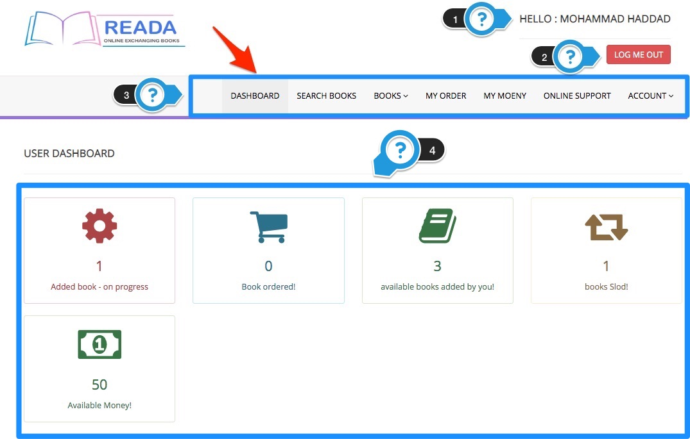
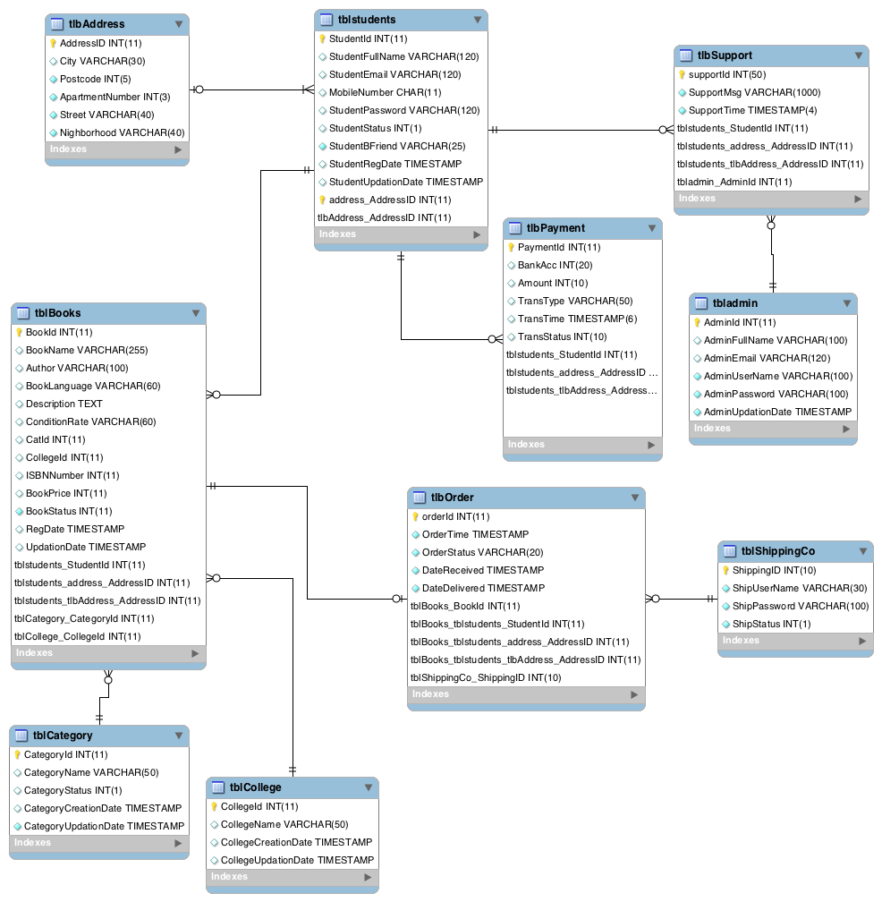

# Reada: Online Bookstore for Used Textbooks

Reada is a web-based system where university students can **buy and sell used textbooks** in an organized and easy way. It was built as a graduation project in 2019.

## The Problem

Every semester students have to buy several expensive books, then throw them away when the semester ends. Many students can't afford new books, and there's no organized place to collect and resell used ones.

## The Solution

Reada lets students:

- **Sell** the used books they no longer need and get back part of the original price
- **Buy** used books in good condition at a lower price
- Take better care of their books, share knowledge, and help the environment

## User Roles

| Role | Main features |
|------|---------------|
| **Student** | Sign up and log in, browse and search books, add books for sale, my books, ordered books, address, wallet / payments, profile, FAQs, support |
| **Admin** | Dashboard, manage books, categories and colleges, registered students, preparing orders, approving payments, shipping company accounts, answering support |
| **Shipping company** | Log in, dashboard, shipping requests, change password |

## My Role

I was the **team leader** of a four-person team, and I worked on both the planning and the technical side of the project.

### Project & Team Leadership
- Came up with the **project idea** and defined the problem Reada solves
- Led the team and organized our work, with meetings twice a week
- Took part in the **system analysis and design** (requirements, diagrams, database design)

### Development
- Built **every page that works with the database**: all the main workflows of the system
- Handled the **database integration** across the whole system
- **Debugged and fixed** coding errors across the project, including code written by other team members

### Features I Built

**Student side**
- **Wallet & financial transactions**: add money, withdraw, view balance, and automatic transfer between buyer and seller on every order\
  `payment.php`
- **Ordering system**: students order books and track their orders\
  `orderedbooks.php`
- **Book management**: "My Books" page and editing listed books\
  `mybooks.php`, `manage-books.php`, `edit-book.php`
- **Address management** for delivery\
  `Address.php`
- **Online support**: students send messages to the admin\
  `support.php`

**Admin side**
- **Transactions panel**: review and approve deposit and withdrawal requests\
  `admin/manage-payment-of.php`
- **Order preparation**: admin prepares orders and hands them to shipping\
  `admin/PreparingOrders.php`
- **Book review**: admin approves books before they're listed, and can edit them\
  `admin/manage-books.php`, `admin/edit-book.php`
- **Student management**: activate or block student accounts\
  `admin/reg-students.php`
- **Shipping company accounts**: create and manage shipping company accounts\
  `admin/mng-shippingCo.php`
- **Support replies**: answer student messages\
  `admin/adminsupport.php`, `admin/responseto.php`

**Shipping company side**
- **Shipping workflow**: view shipping requests and update pickup and delivery status\
  `ShippingReq.php`

**All users**
- **Role-based dashboards**: a separate dashboard for each user type (student, admin, shipping company)\
  `dashboard.php`, `admin/dashboard.php`, `ShipCoDash.php`

### Skills Used
PHP · MySQL · PDO · HTML/CSS · Bootstrap · Systems Analysis & Design · Database Design (ERD, Normalization) · Team Leadership

## Tech Stack

- PHP (PDO)
- MySQL
- HTML, CSS, Bootstrap, jQuery

## Project Structure

```
Reada/
├── src/                 # PHP source code (copy this into htdocs/reada)
│   ├── admin/           # Admin panel
│   ├── includes/        # Shared header, footer, DB config
│   └── assets/          # CSS, JS, fonts, images
├── database/
│   ├── ReadaDB.sql      # Database dump to import (with demo data)
│   ├── reada_schema.*   # Database design (SQL + MySQL Workbench model)
│   └── erd.png
└── docs/
    ├── report/          # Final report, submission, abstract, presentation, FAQs
    ├── diagrams/        # Context diagram, DFD, ERD, site map
    └── user-manual/     # Screenshots for student, admin and shipping company
```

## Running Locally

1. Install [XAMPP](https://www.apachefriends.org/) (or WAMP/MAMP).
2. Copy the `src` folder into `htdocs` and rename it to `reada`.
3. Open phpMyAdmin, create a database called `ReadaDB`, and import `database/ReadaDB.sql`.
4. If needed, change the database settings in `src/includes/config.php` and `src/admin/includes/config.php`.
5. Open <http://localhost/reada/>.

### Demo Accounts

| Role | Login | Password |
|------|-------|----------|
| Student | `student1@example.com` | `student123` |
| Student | `student2@example.com` | `student123` |
| Admin | `admin` | `admin123` |
| Shipping company | `DHL` | `1234` |

## Screenshots

| Student dashboard | Search books | Admin dashboard |
|---|---|---|
|  |  |  |

## Database Design



## Notes

- This is an academic project from 2019, so it isn't production-ready (for example, passwords are stored as MD5 hashes).
- The project started from an open-source PHP/MySQL *Library Management System* template, which was extended into a used-book marketplace.
